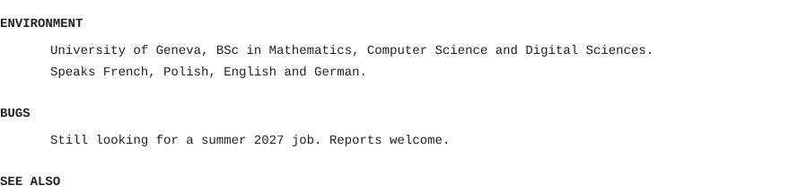

<!-- Généré par assets/build.py : une page de manuel `man oscar`. -->

<picture><source media="(prefers-color-scheme: dark)" srcset="assets/top-dark.svg"></picture> 
<a href="https://github.com/Th3drata/Parseledger"><picture><source media="(prefers-color-scheme: dark)" srcset="assets/ex-parseledger-dark.svg"></picture></a> 
<a href="https://github.com/Th3drata/VirtuLouvre"><picture><source media="(prefers-color-scheme: dark)" srcset="assets/ex-virtulouvre-dark.svg"></picture></a> 
<a href="https://github.com/Th3drata/Monetia"><picture><source media="(prefers-color-scheme: dark)" srcset="assets/ex-monetia-dark.svg"></picture></a> 
<a href="https://github.com/Th3drata/SecureDropLite"><picture><source media="(prefers-color-scheme: dark)" srcset="assets/ex-securedroplite-dark.svg"></picture></a> 
<picture><source media="(prefers-color-scheme: dark)" srcset="assets/middle-dark.svg"></picture> 
<a href="https://www.linkedin.com/in/oscar-albert"><picture><source media="(prefers-color-scheme: dark)" srcset="assets/see-linkedin-dark.svg"></picture></a><a href="mailto:oscar.albert@free.fr"><picture><source media="(prefers-color-scheme: dark)" srcset="assets/see-mail-dark.svg"></picture></a><a href="https://www.oscaralbert.fr/resume"><picture><source media="(prefers-color-scheme: dark)" srcset="assets/see-resume-dark.svg"></picture></a> 
<picture><source media="(prefers-color-scheme: dark)" srcset="assets/bottom-dark.svg"></picture>

