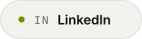
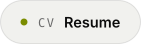

<a href="https://www.oscaralbert.fr">
  <picture>
    <source media="(prefers-color-scheme: dark)" srcset="assets/header-dark.svg">
    
  </picture>
</a>

  <a href="https://www.oscaralbert.fr"><picture><source media="(prefers-color-scheme: dark)" srcset="assets/pill-web-dark.svg"></picture></a>
  <a href="https://www.linkedin.com/in/oscar-albert"><picture><source media="(prefers-color-scheme: dark)" srcset="assets/pill-in-dark.svg"></picture></a>
  <a href="mailto:oscar.albert@free.fr"><picture><source media="(prefers-color-scheme: dark)" srcset="assets/pill-mail-dark.svg"></picture></a>
  <a href="https://www.oscaralbert.fr/resume"><picture><source media="(prefers-color-scheme: dark)" srcset="assets/pill-cv-dark.svg"></picture></a>

<picture><source media="(prefers-color-scheme: dark)" srcset="assets/section-about-dark.svg"></picture>

I build websites and web applications, from the first mockup to production.

I run **[Belvédère](https://www.belvedere-group.fr)**, my web development business: custom websites and web apps for freelancers, craftspeople and small businesses, with around sixty sites delivered so far (client projects, prototypes and demos). I also built **[Fit AI](https://www.fit-ai.fr)** on my own, an iOS coaching app that generates workout programs and meal plans with AI, now on the App Store.

On the side, I like getting close to the metal: low-level systems, security, and CTFs on HackTheBox and TryHackMe.

<picture><source media="(prefers-color-scheme: dark)" srcset="assets/section-now-dark.svg"></picture>

- 🎓 &nbsp;Bachelor in Mathematics, Computer Science and Digital Sciences at the **University of Geneva**
- 🛠️ &nbsp;Shipping client websites and web apps at **Belvédère**
- 📍 &nbsp;Looking for a **fixed-term or student job in Geneva**, especially for summer 2027

<picture><source media="(prefers-color-scheme: dark)" srcset="assets/section-work-dark.svg"></picture>

  <a href="https://github.com/Th3drata/Parseledger"><picture><source media="(prefers-color-scheme: dark)" srcset="assets/card-parseledger-dark.svg"></picture></a>
  <a href="https://github.com/Th3drata/VirtuLouvre"><picture><source media="(prefers-color-scheme: dark)" srcset="assets/card-virtulouvre-dark.svg"></picture></a>
  <a href="https://github.com/Th3drata/Monetia"><picture><source media="(prefers-color-scheme: dark)" srcset="assets/card-monetia-dark.svg"></picture></a>
  <a href="https://github.com/Th3drata/SecureDropLite"><picture><source media="(prefers-color-scheme: dark)" srcset="assets/card-securedroplite-dark.svg"></picture></a>

<picture><source media="(prefers-color-scheme: dark)" srcset="assets/section-stack-dark.svg"></picture>

  <!-- ponytail: pas de <picture> ici, les virgules de l'URL cassent srcset -->
  

**Speaks** &nbsp;French (native) · Polish (native) · English (B2, Cambridge First) · German (B2, GLS)

 

<a href="https://www.oscaralbert.fr">
  <picture>
    <source media="(prefers-color-scheme: dark)" srcset="assets/footer-dark.svg">
    
  </picture>
</a>
