<picture>
  <source media="(prefers-color-scheme: dark)" srcset="assets/header-dark.svg">
  
</picture>

  <a href="https://www.oscaralbert.fr"><picture><source media="(prefers-color-scheme: dark)" srcset="assets/link-web-dark.svg">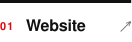</picture></a>&nbsp;&nbsp;
  <a href="https://www.linkedin.com/in/oscar-albert"><picture><source media="(prefers-color-scheme: dark)" srcset="assets/link-in-dark.svg">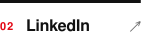</picture></a>&nbsp;&nbsp;
  <a href="mailto:oscar.albert@free.fr"><picture><source media="(prefers-color-scheme: dark)" srcset="assets/link-mail-dark.svg">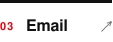</picture></a>&nbsp;&nbsp;
  <a href="https://www.oscaralbert.fr/resume"><picture><source media="(prefers-color-scheme: dark)" srcset="assets/link-cv-dark.svg"></picture></a>

 

<picture><source media="(prefers-color-scheme: dark)" srcset="assets/section-about-dark.svg">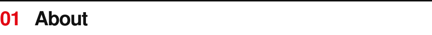</picture>

I build websites and web applications, from the first mockup to production.

I run **[Belvédère](https://www.belvedere-group.fr)**, my web development business: custom websites and web apps for freelancers, craftspeople and small businesses, with around sixty sites delivered so far (client projects, prototypes and demos). I also built **[Fit AI](https://www.fit-ai.fr)** on my own, an iOS coaching app that generates workout programs and meal plans with AI, now on the App Store.

On the side, I like getting close to the metal: low-level systems, security, and CTFs on HackTheBox and TryHackMe.

 

<picture><source media="(prefers-color-scheme: dark)" srcset="assets/section-now-dark.svg">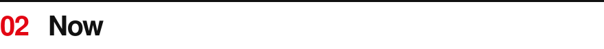</picture>

**Studying** &nbsp;Bachelor in Mathematics, Computer Science and Digital Sciences at the University of Geneva 
**Building** &nbsp;client websites and web apps at Belvédère 
**Looking for** &nbsp;a fixed-term or student job in Geneva, especially for summer 2027

 

<picture><source media="(prefers-color-scheme: dark)" srcset="assets/section-work-dark.svg">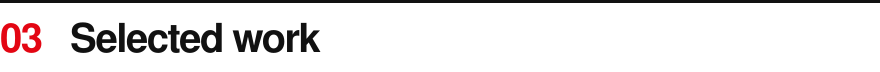</picture>

  <a href="https://github.com/Th3drata/Parseledger"><picture><source media="(prefers-color-scheme: dark)" srcset="assets/card-parseledger-dark.svg">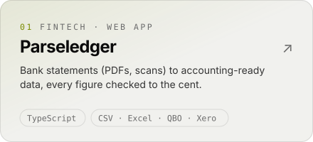</picture></a>&nbsp;&nbsp;&nbsp;
  <a href="https://github.com/Th3drata/VirtuLouvre"><picture><source media="(prefers-color-scheme: dark)" srcset="assets/card-virtulouvre-dark.svg">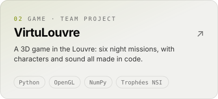</picture></a>

  <a href="https://github.com/Th3drata/Monetia"><picture><source media="(prefers-color-scheme: dark)" srcset="assets/card-monetia-dark.svg">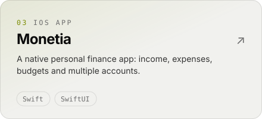</picture></a>&nbsp;&nbsp;&nbsp;
  <a href="https://github.com/Th3drata/SecureDropLite"><picture><source media="(prefers-color-scheme: dark)" srcset="assets/card-securedroplite-dark.svg">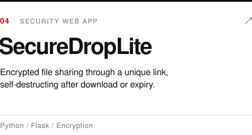</picture></a>

 

<picture><source media="(prefers-color-scheme: dark)" srcset="assets/section-stack-dark.svg">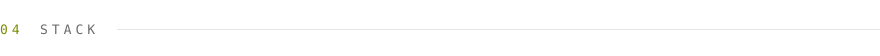</picture>

<picture><source media="(prefers-color-scheme: dark)" srcset="assets/stack-dark.svg">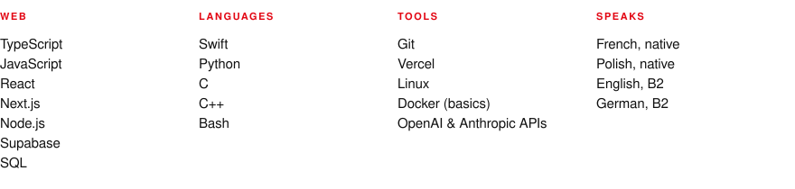</picture>

 

<a href="mailto:oscar.albert@free.fr"><picture><source media="(prefers-color-scheme: dark)" srcset="assets/footer-dark.svg">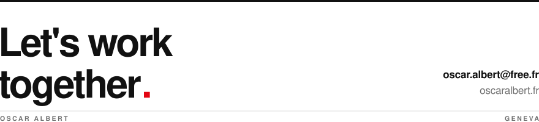</picture></a>
